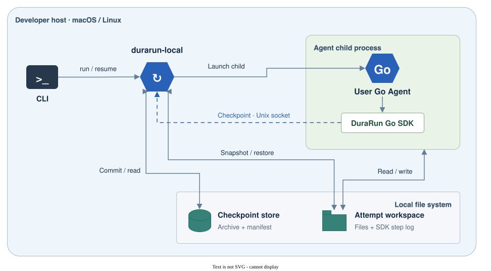

# DuraRun Go SDK

English · [简体中文](README.zh-CN.md)

DuraRun is a Go SDK and local runner for Agent jobs. Save progress at a checkpoint, then resume after an interruption. The runner restores the workspace and the SDK skips steps recorded as complete in that checkpoint.

Developer preview for macOS and Linux.



## Install the SDK

From your Go project, install the [current preview](https://github.com/Chao-superw/durarun-go/releases/tag/v0.1.0-preview).

```sh
go get github.com/Chao-superw/durarun-go/runtime@v0.1.0-preview
```

## Quickstart

Use Go 1.26 or later on macOS or Linux. From the root of this checkout:

```sh
mkdir -p ./bin
go build -o ./bin/durarun-local ./cmd/durarun-local
go build -o ./bin/sdk-agent ./examples/sdk-agent
SDK_EXAMPLE_PAUSE=1 ./bin/durarun-local run -state ./agent-run -- ./bin/sdk-agent "inspect source"
```

Wait for `checkpoint committed`, then press Ctrl+C. Resume with:

```sh
./bin/durarun-local resume -state ./agent-run
```

Open `report.md` in the workspace printed by the runner. It should contain the recovered input, and the resumed process should skip the inspection step. Use a fresh state directory for each new run and keep the executable at its original path when resuming.

## Integrate your Agent

Import `github.com/Chao-superw/durarun-go/runtime` and initialize it with `Config{Durable: true}`. Call `Run` around your Agent entry point, use `Step` with stable IDs for recoverable work, and call `Checkpoint` between steps. Save any state later steps need in the runner workspace.

The checkpoint stores workspace files and step history. On resume, the Agent starts from its entry point and the SDK skips steps completed in the restored checkpoint. Work after that checkpoint may run again. Use application-level idempotency for external writes and other side effects.

See the [integration guide](docs/go-sdk-preview.md) and the [runnable Go example](examples/sdk-agent/main.go).

## Tests

Run `go test ./...` from this directory.

[Contributing](CONTRIBUTING.md) · [Security policy](SECURITY.md)

## License

[Apache-2.0](LICENSE)
