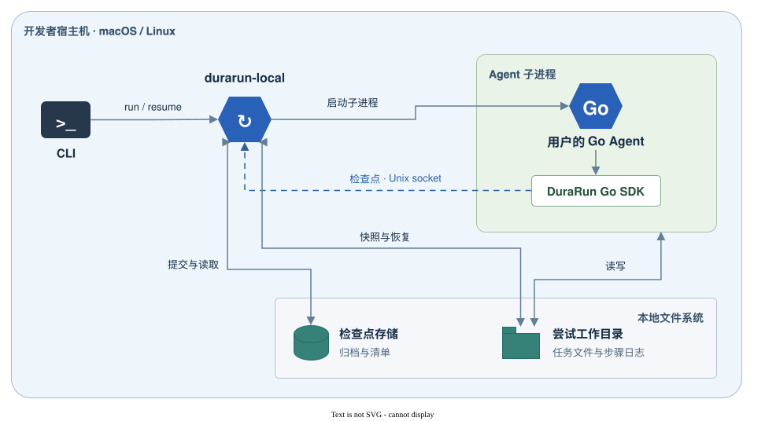

# DuraRun Go SDK

[English](README.md) · 简体中文

DuraRun 提供 Go SDK 和本地 Runner。Agent 可以保存检查点，进程中断后从检查点续跑。Runner 恢复工作目录，SDK 跳过恢复点中已记录为完成的步骤。

这是面向 macOS 和 Linux 的开发者预览版。



## 快速开始

在 macOS 或 Linux 上使用 Go 1.26 或更高版本。在源码目录下运行：

```sh
mkdir -p ./bin
go build -o ./bin/durarun-local ./cmd/durarun-local
go build -o ./bin/sdk-agent ./examples/sdk-agent
SDK_EXAMPLE_PAUSE=1 ./bin/durarun-local run -state ./agent-run -- ./bin/sdk-agent "inspect source"
```

看到 `checkpoint committed` 后按 Ctrl+C，再执行：

```sh
./bin/durarun-local resume -state ./agent-run
```

在 Runner 输出的工作目录中打开 `report.md`。报告应包含恢复出的输入，续跑进程会跳过已经完成的检查步骤。每次启动新任务时请使用新的状态目录，恢复时保留可执行文件的原路径。

## 接入自己的 Agent

预览版标签发布后，在你的 Go 项目中运行：

```sh
go get github.com/Chao-superw/durarun-go/runtime@v0.1.0-preview
```

发布前，可在应用的 `go.mod` 中引用本地源码：

```go
require github.com/Chao-superw/durarun-go v0.0.0
replace github.com/Chao-superw/durarun-go => /absolute/path/to/durarun-go
```

导入 `github.com/Chao-superw/durarun-go/runtime`，用 `Config{Durable: true}` 初始化 SDK。用 `Run` 包住 Agent 入口，用具有稳定 ID 的 `Step` 标记可恢复的步骤，在步骤之间调用 `Checkpoint`。把后续步骤需要的状态写入 Runner 的工作目录。

Checkpoint 保存工作目录文件和步骤记录。恢复时，Agent 从入口重新执行，SDK 跳过恢复点里已完成的步骤。恢复点之后的操作可能重跑，外部写入和其他有副作用的操作需要由应用保证幂等。

参考 [接入指南（英文）](docs/go-sdk-preview.md)和[可运行的 Go 示例](examples/sdk-agent/main.go)。

## 测试

在当前目录运行 `go test ./...`。

## 许可证

[Apache-2.0](LICENSE)
